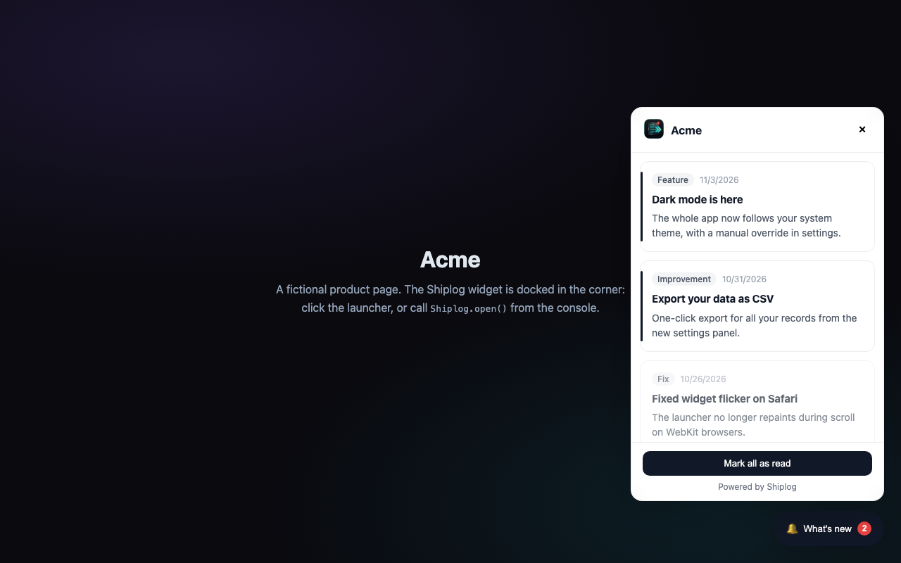

<p align="center">
	
</p>

<h1 align="center">shiplog-widget</h1>

<p align="center">
	The embeddable changelog widget for <a href="https://shiplog.cc?ref=gh-repo-shiplog-widget">Shiplog</a>. The exact MIT-licensed code your visitors' browsers run.
</p>

<p align="center">
	<a href="https://shiplog.cc">Website</a>
	|
	<a href="https://shiplog.cc/changelog/shiplog">Changelog</a>
	|
	<a href="#try-the-demo">Demo</a>
	|
	<a href="https://shiplog.cc/pricing">Pricing</a>
</p>

<p align="center">
	<a href="https://github.com/imtiazraqib/shiplog-widget/blob/main/LICENSE"></a>
	<a href="https://github.com/imtiazraqib/shiplog-widget/releases"></a>
	<a href="https://shiplog.cc"></a>
</p>



One `<script>` tag adds a notification launcher to your product: an unread badge, a scrollable updates feed with categories and dates, read tracking per visitor, and deep links back to your public changelog. No dependencies, no build step, served from `shiplog.cc/widget.js`.

## Install

```html
<script src="https://shiplog.cc/widget.js"></script>
<script>
	Shiplog.init({
		appKey: 'your_widget_key'
	});
</script>
```

Get your `appKey` (an `slk_...` widget key) from your app's Widget installation page in the <a href="https://shiplog.cc?ref=gh-repo-shiplog-widget">Shiplog</a> dashboard.

## Init options

| Option         | Type    | Description                                                                  |
| -------------- | ------- | ---------------------------------------------------------------------------- |
| `appKey`       | string  | **Required.** Your app's widget key                                          |
| `position`     | string  | `'bottom-left'` to pin the launcher left; default is bottom-right            |
| `hideLauncher` | boolean | `true` renders the floating button hidden (use with `trigger` or the JS API) |
| `trigger`      | string  | CSS selector for your own element(s) that toggle the panel on click          |
| `accentColor`  | string  | Hex color (`#rgb` or `#rrggbb`) for the launcher, badges, and accents        |
| `userId`       | string  | Your own user ID for read tracking; omit for anonymous visitors              |

## Programmatic API

```js
Shiplog.open(); // open the updates panel
Shiplog.close(); // close it
Shiplog.toggle(); // toggle it
```

Safe to call before `init()`; open/toggle queue until the widget is created.

## Read tracking

Anonymous visitors get a localStorage-backed `shiplog:anonymous-id` automatically, so the unread badge reflects what each visitor has actually seen. Pass `userId` to track reads against your own user identity instead.

## Try the demo

`demo/index.html` loads the real `widget.js` against a stubbed feed, no account needed:

```bash
python3 -m http.server 8000   # or: npx serve .
# open http://localhost:8000/demo/?open
```

## Notes

- The script resolves its API origin from its own `<script src>`, so it works from any page that can reach `shiplog.cc`.
- The `/api/widget/*` endpoints it calls are part of the hosted Shiplog service and are CORS-open by design.
- `widget.js` ships as-is: no bundling, no transpilation.

## Contributing

PRs welcome for widget internals (rendering, a11y, init API). Features that need backend or API changes live in the hosted service; open an issue here first and it will be routed. See [CONTRIBUTING.md](CONTRIBUTING.md).

## License

[MIT](LICENSE)
